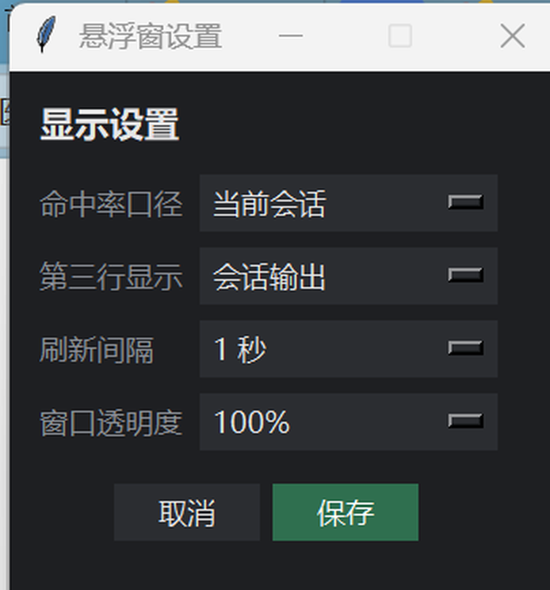

# WorkBuddy HUD

> WorkBuddy 缓存命中率与生成速率的实时悬浮窗。

一个常驻桌面的置顶小窗，实时显示 WorkBuddy（腾讯 AI 工作台）的**缓存命中率**与**生成速率**。数据完全来自本地会话日志，只读、不联网、不上传。


---

## 功能特性

| 特性 | 说明 |
|------|------|
| **双口径命中率** | 当前会话 / 全历史，设置里切换，避免单一口径失真 |
| **实时速率** | 最近 60 秒的端到端生成吞吐（tok/s） |
| **7 种附加指标** | 会话输出、全历史输出、上下文用量、请求次数、会话时长、模型名称、未命中 token |
| **原生悬浮窗** | 深色圆角、无边框、置顶、可拖动、可调透明度 |
| **零依赖** | 纯 Python 标准库（tkinter），不需要 pip 安装任何包 |
| **纯本地** | 只读 `~/.workbuddy/projects`，零网络请求，不读对话正文 |

## 界面

| 主界面 | 设置窗口 |
|--------|----------|
|  |  |

三行布局：

```
命中率 98.1%              ← 命中率，≥60% 绿 / 30~60% 黄 / <30% 红
89.0 tok/s                ← 最近 60 秒生成吞吐
会话 283.9K tok · 345 条   ← 第三行，可配置
```

## 快速开始

### 方式一：直接运行（推荐）

从 [Releases](../../releases) 下载 `WorkBuddy-HUD.exe`，双击运行，无需安装 Python。

### 方式二：源码运行

```bash
git clone https://github.com/liupeng2268/workbuddy-hud.git
cd workbuddy-hud
pythonw "最终成果/WorkBuddy悬浮窗.pyw"
```

要求 Python 3.9+ 且包含 tkinter（Windows 官方安装包默认自带）。

> 若双击 `.pyw` 无反应，说明系统 `.pyw` 文件关联缺失（Windows 上常见），改用 `最终成果/启动.bat`，或按方式三自行打包。

### 方式三：自行打包 exe

```bash
pip install pyinstaller
pyinstaller --noconfirm --clean --onefile --windowed \
  --name "WorkBuddy悬浮窗" \
  --distpath "最终成果/dist" --workpath "build" \
  "最终成果/WorkBuddy悬浮窗.pyw"
```

产物在 `最终成果/dist/` 目录，约 11 MB。

## 验证

```bash
python tests/verify_data_reader.py
```

9 个用例 / 30 项断言，覆盖增量追加、半行补完、子代理日志归属、双口径记账、截断重写、大文件头部入账与速率空闲归零。全部在系统临时目录内造数据，不触碰你的真实日志；退出码 0 表示通过。改动 `data_reader.py` 的读取或记账逻辑后请重跑。

## 使用

| 操作 | 效果 |
|------|------|
| 按住拖动 | 移动窗口位置 |
| 右键 → 设置… | 打开设置窗口 |
| 右键 → 刷新 | 立即重新读取 |
| 右键 → 复制快照 | 把全部指标复制到剪贴板 |
| 右键 → 退出 | 关闭程序 |

## 设置项

保存后立即生效，写入程序同目录 `设置.json`。

| 设置项 | 可选值 | 默认 |
|--------|--------|------|
| 命中率口径 | 当前会话 / 全历史 | 当前会话 |
| 第三行显示 | 会话输出 / 全历史输出 / 上下文用量 / 请求次数 / 会话时长 / 模型名称 / 未命中 token / 隐藏 | 会话输出 |
| 刷新间隔 | 0.5 / 1 / 2 / 5 秒 | 1 秒 |
| 窗口透明度 | 100% / 95% / 90% / 85% / 80% | 100% |

## 指标口径

| 指标 | 计算方式 | 说明 |
|------|----------|------|
| 命中率 | `prompt_cache_hit_tokens ÷ (hit + miss)` | 按 token 量加权，不是按调用次数平均 |
| 速率 | 最近 60 秒 `completion_tokens` 之和 ÷ 窗口跨度 | **端到端吞吐**，含模型思考与工具等待，非纯解码速率 |
| 上下文用量 | 最新一条请求的 `prompt_tokens` | 即当前上下文长度 |
| 未命中 token | `prompt_cache_miss_tokens` 累计 | 反映真实输入消耗 |

### 两种命中率口径

| 口径 | 特点 | 适用 |
|------|------|------|
| 当前会话 | 只统计当前对话（含其 subagents），随对话实时变化，通常 97%~98% | 想知道「这次对话缓存打得好不好」 |
| 全历史 | 全部日志累计加权，稳定在 96.4% 附近 | 想知道「长期平均缓存效率」 |

「当前会话」的判定：`projects/<项目>/<会话uuid>.jsonl` 中修改时间最新的主日志，加上该会话目录下 `subagents/*.jsonl` 的全部记录。切换到别的对话后自动跟随。

## 实现要点

- **双口径独立统计**：会话与历史各有一套 `(size, offset)` 表，互不干扰；会话切换只重置会话口径，历史保持连续
- **后台线程扫描**：`snapshot()` 只做内存汇总（实测 0.02~0.25 ms），不触发磁盘 IO，不阻塞 UI
- **增量读取**：按文件 offset 只读新增字节，只解析完整行，避免半截 JSON 与重复计数
- **首次加载**：会话口径约 1 秒，历史口径约 2~3 秒（324 文件 / 354 MB / 2.2 万条记录），期间界面显示占位

## 数据来源与隐私

- 只读取 `~/.workbuddy/projects/` 下的 `*.jsonl` 会话日志
- **纯只读**：不修改、不移动、不删除任何文件
- **零网络**：无 HTTP 请求，不需要 API Key
- 只解析 token 计数字段，不读取对话正文内容

## 已知限制

- 命中率为累计口径，分母很大时数值变化缓慢（这正是想要「实时波动」时应切到当前会话口径的原因）
- 速率在最近 60 秒无生成活动时显示 `--`
- 无边框窗口只能通过右键菜单退出
- 切换会话瞬间数值会归零重算

## 文件结构

```
workbuddy-hud/
├── README.md
├── LICENSE
├── GLOSSARY.md                   # 领域术语表（口径、记账权、偏移…）
├── 最终成果/                     # 可交付成品，克隆后可直接运行
│   ├── WorkBuddy悬浮窗.pyw       # 程序入口
│   ├── data_reader.py            # 数据层：日志扫描与双口径统计
│   ├── floating_ui.py            # 界面层：悬浮窗与设置窗口
│   ├── 启动.bat                  # 备用启动脚本
│   ├── 接口约定.md               # 两模块的接口契约
│   ├── 使用说明.md               # 详细使用文档
│   ├── docs/                     # 截图
│   └── dist/                     # 打包产物（exe 与 设置.json，不入库）
├── tests/                        # 回归用例（数据层口径与增量读取）
├── docs/adr/                     # 架构决策记录
├── 过程脚本/                     # 开发期探查脚本（仅作者本地，不入库）
├── 原始材料/                     # 外部输入材料（本项目无，不入库）
└── _临时/                        # 打包缓存、调试截图、历史版本（不入库）
```

源码、`启动.bat`、`docs/`、`dist/` 在 `最终成果/` 内保持同级，因此三者之间的相对路径与程序内的 `BASE_DIR` 逻辑无需改动。

## 许可证

[MIT](LICENSE)

## 免责声明

本项目为个人开发的开源工具，与腾讯公司无关。数据读取仅限本机文件，使用时请自行确认符合相关服务条款。
